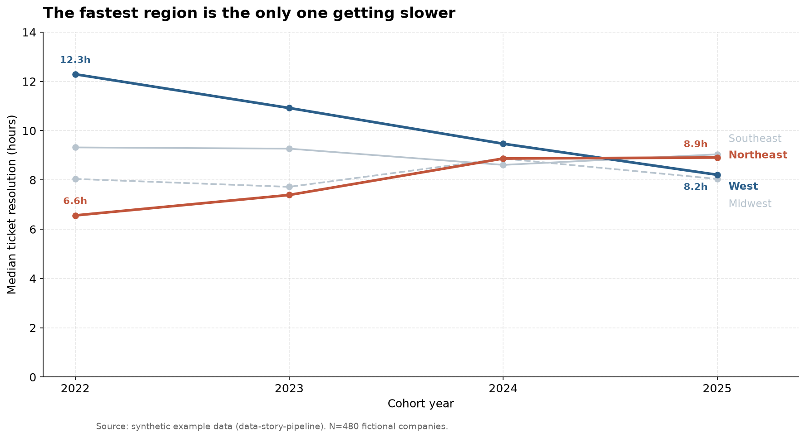

# Four regions, four years, and the disappearance of a competitive advantage

> **Worked example built from synthetic data.** No real company or dataset is
> represented. Generated by `analysis/`; every number is reproducible via
> `python3 analysis/compute.py --validate`. This file demonstrates the *exploratory*
> article mode from the `write-story` skill.

## The question

Regional performance gaps are one of the most-reported cuts in operational benchmarking, and one of the least examined over time. A single-year snapshot showing one region outperforming another gets published constantly. What almost never gets asked is whether that gap is stable — whether being in the fast region in 2022 still means anything in 2025.

We looked at four years of cohort data to see whether regional differences in support performance persist, widen, or wash out.

## What we looked at

480 fictional B2B SaaS companies, evenly split across four regions and four annual cohorts (2022–2025), 30 companies per region-cohort cell. For each we have median ticket resolution time in hours, monthly ticket volume, headcount, and a satisfaction score.

We also tested whether resolution speed actually predicts satisfaction, since the entire premise of tracking it assumes that it does.

## The regional gap collapsed, and not for the reason you'd guess

The headline is convergence. In the 2022 cohort, the spread between the fastest and slowest region was 5.73 hours. By the 2025 cohort it was 1.00 hour — a decline of 82.5%.

| Region | 2022 | 2023 | 2024 | 2025 | Change |
|---|---|---|---|---|---|
| Northeast | 6.56 | 7.39 | 8.87 | 8.91 | **+35.8%** |
| Southeast | 9.32 | 9.27 | 8.61 | 9.04 | −3.0% |
| Midwest | 8.04 | 7.72 | 8.87 | 8.04 | 0.0% |
| West | 12.29 | 10.92 | 9.47 | 8.21 | **−33.2%** |
| *Best-worst gap* | *5.73* | *3.53* | *0.86* | *1.00* | *−82.5%* |

**Notable:** convergence arrived from both directions simultaneously. The West, the worst performer in 2022 at 12.3 hours, improved 33.2%. The Northeast, the best performer at 6.6 hours, degraded 35.8% — and is the only region that moved meaningfully in the wrong direction. Southeast and Midwest were flat.

That distinction matters for interpretation. A story where laggards catch up is a story about diffusion — best practices spreading, tooling commoditizing. A story where the leader simultaneously regresses is something else. The two middle regions holding flat while the extremes traded places suggests the pack has a gravitational center that both outliers are being pulled toward.

## The comparison everyone makes is the least useful one

The regional cut is the one that gets reported. It is also, on this data, close to meaningless — because the variation inside each region dwarfs the variation between them.

| Region | P10 | P25 | Median | P75 | P90 | P90−P10 |
|---|---|---|---|---|---|---|
| Northeast | 4.74 | 6.22 | 7.97 | 9.47 | 10.53 | 5.78 |
| Southeast | 6.77 | 7.71 | 9.20 | 11.25 | 12.33 | 5.56 |
| Midwest | 5.59 | 6.58 | 8.00 | 9.33 | 10.58 | 4.99 |
| West | 6.98 | 8.23 | 10.32 | 12.01 | 14.07 | 7.10 |

**Notable:** the entire between-region gap in medians is 2.35 hours. The *narrowest* within-region spread — Midwest, at 4.99 hours from P10 to P90 — is more than double that. A P90 company in the fastest region resolves tickets more slowly than a P10 company in the slowest one.

Knowing which region a company operates in is close to worthless as a predictor of how fast it resolves tickets. Knowing where it sits in its own region's distribution tells you nearly everything.

## What we checked to explain it

We wanted to know whether resolution speed is worth tracking at all, so we tested it against satisfaction directly.

It holds up, with a caveat. Resolution time and CSAT correlate at r = −0.694, and each additional hour costs about 0.131 CSAT points. That is a real, substantial relationship — slower support does make customers less happy, and the effect size is large enough to act on.

But R² is 0.482. Resolution speed explains slightly under half the variance in satisfaction. The majority sits somewhere we didn't measure: resolution quality, first-contact resolution rate, tone, whether the problem stayed fixed. A team that drove resolution time to zero would still be leaving most of the satisfaction question unanswered.

## What we can and can't conclude

**The data supports:** regional differences in resolution time have largely disappeared over four cohorts, and the convergence is driven about equally by the laggard improving and the leader declining. Within-region variation exceeds between-region variation by a wide margin in every region.

**The data is consistent with, but cannot prove:** that regional advantage in support operations is structurally short-lived. Four cohorts is a short window, and we observe convergence without observing its mechanism. Tooling commoditization, talent mobility, and changing customer expectations would all produce this pattern, and we cannot distinguish between them here.

**Alternative explanations we can't rule out:** composition change within cohorts, a measurement or definitional shift in what counts as "resolution," or the possibility that the Northeast's degradation reflects growth into harder customer segments rather than declining execution. Any of these would produce the observed convergence without the interpretation above being correct.

**What would settle it:** company-level longitudinal tracking rather than cohort snapshots. Following the same companies across all four years would separate "companies got slower" from "slower companies entered the sample."

## Caveats and methodology

Synthetic dataset of 480 fictional companies, 30 per region-cohort cell, generated with a fixed random seed. Resolution times are drawn from per-region normal distributions with a per-year drift term; satisfaction is a linear function of resolution time plus noise. Because the data is generated rather than observed, the relationships described here are ones we built into it — this article demonstrates the analytical and narrative *form*, not a finding about the real world.

Cohort assignment is fixed at company creation and companies do not move between cohorts. All percentile figures pool cohorts within a region. Percentiles use linear interpolation.
